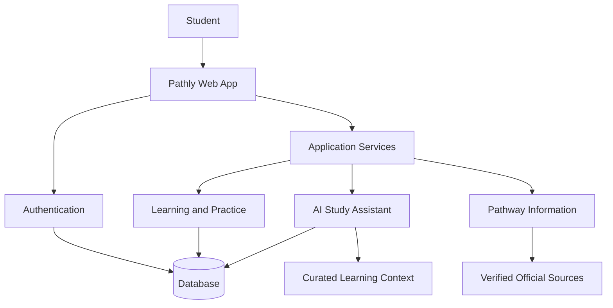

# Proposed System Architecture

## Components
- **Web app:** responsive pages, onboarding, dashboard and student interactions.
- **Authentication:** secure sign-in and session handling.
- **Application services:** server-side learning, practice, progress, pathway and AI operations.
- **Database:** profiles, learning records, attempts and progress, protected by per-user access policies.
- **AI assistant:** receives only relevant context and returns explanations or practice support. API credentials stay server-side.
- **Pathway information:** curated records with provider, official source URL, applicable year and last-checked date.

## Trust boundaries
Treat browser input as untrusted. Authenticate and authorise server requests. Do not trust client-supplied user IDs for access decisions. Do not expose secrets. Do not use an AI model as the source of truth for current admissions requirements.

## Operations
Plan for privacy-conscious logging, monitoring, backups, rate limits, AI cost tracking and a process for correcting outdated pathway information.
